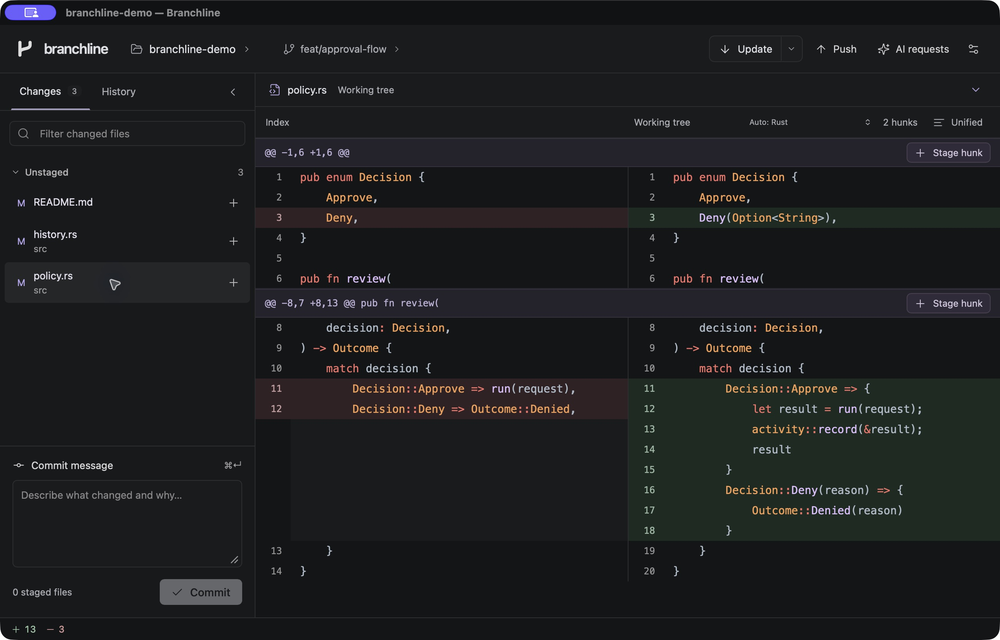

<p align="center">
  
</p>

<p align="center"><strong>A quieter Git client. A clear permission gate for AI.</strong></p>
<p align="center">Review your changes, understand the plan, and decide what runs.</p>

<p align="center">
  
  
  <a href="LICENSE"></a>
</p>

<p align="center">
  <a href="#why-branchline">Why Branchline</a> ·
  <a href="#ai-workflows-with-a-human-decision">AI approval</a> ·
  <a href="#run-locally">Run locally</a> ·
  <a href="#documentation">Documentation</a>
</p>



<p align="center"><sub>The actual macOS app, shown with a synthetic demo repository.</sub></p>

## Why Branchline

Your Git client should make changes easier to understand. Your AI assistant should make its next action easier to review.

Branchline brings both into one macOS app: a focused Git workspace inspired by familiar IDE workflows, and a local MCP connector that asks for your approval before executing an AI's command. Built with **Tauri 2, Rust, and TypeScript**, with a compact interface, local assets, and a dark theme you can tune to your eyes.

| Review your code | Review your AI's next move |
| --- | --- |
| Split and unified diffs with syntax highlighting | One visual request for the entire command chain |
| File and hunk staging with explicit commit messages | Commit, branch, push, and PR details when statically understood |
| Commit graph, history search, and contextual actions | Approve, deny, or deny with a reason |
| Branch switching, fetch-only, update, and push | AI waits for the recorded result; timeout never grants approval |
| Image previews, resizable panels, and multiple windows | Local activity with commands, identity, timestamps, and export |

## AI workflows with a human decision

**Plan → review → approve or deny → execute → report the result.**

Connect an AI client once through **AI requests → Connections**. The onboarding guide provides the MCP setup fields or commands for your client and optional skill installation. Connections work across local repositories; each request identifies its own target.

An assistant can request a complete workflow, for example:

```sh
git add -- src/policy.rs &&
git commit -m "Record approval decisions in activity history" &&
git push --set-upstream origin feat/activity-history &&
gh pr create \
  --title "Record approval decisions in activity history" \
  --body "Keep command outcomes and approval decisions together." \
  --head feat/activity-history \
  --base main
```

Branchline preserves the command as written. Recognized operations receive structured review cards; stage and commit cards can open read-only file diffs. Publishing to a primary branch or pushing between differently named branches is highlighted when detected. Runtime expressions and unsupported preview syntax remain explicit uncertainties, with the exact command available to inspect.

Approval covers **the whole command**, including its shell control flow. There is no partial-approval mode, and MCP has no approval endpoint. The user makes the decision in Branchline; the AI waits and reports the actual recorded outcome.

> **A permission gate, not a sandbox.** Approved commands run noninteractively as your user account and may invoke Git hooks, credential helpers, shell programs, or GitHub CLI extensions. A successful exit confirms process success, not independently verified effects. Background or deliberately detached work can outlive the shell or its timeout. Inspect state before retrying an interrupted command.

Command output is withheld from durable receipts because it may contain secrets. Exact command inputs are retained locally, so keep credentials out of arguments and standard input. Optional source-diff access is a separate connection setting. See the [connector guide](docs/MCP_CONNECTOR.md) for setup, privacy, and execution limits.

## A focused Git workspace

- **Review and commit.** Open a repository, select a file, inspect its diff, stage individual hunks or whole files, and commit the staged result. Stale snapshots are checked before sensitive operations.
- **Navigate history.** Browse a commit graph, search loaded history, inspect historical files, and use contextual actions to squash, reword, cherry-pick, revert, or branch from a commit. History rewrites have safety checks and recovery refs.
- **Work with branches and remotes.** Search cached branches, switch, create, rename, or push a branch. Update fetches and fast-forwards; its menu offers fetch without pulling.
- **Make room for the task.** Resize or collapse the files, log, and diff panels. Open repositories in separate windows. Adjust interface text, code size, spacing, and contrast.
- **Keep the view current.** Local repository changes refresh automatically, with selection and scrolling preserved. Automatic refresh does not fetch or pull.

## Install on macOS

On an **Apple Silicon Mac running macOS 12 or later**:

```sh
curl -fsSL https://raw.githubusercontent.com/ShindouMihou/branchline/main/scripts/install.sh | bash
```

The installer downloads the latest [GitHub release](https://github.com/ShindouMihou/branchline/releases/latest), verifies its SHA-256 checksum, checks the app bundle identity and signature, and installs to `~/Applications/Branchline.app`. It requires no `sudo` and preserves an existing copy if replacement fails. Quit the Branchline GUI before updating.

Prefer to inspect the script first? [Read the installer](scripts/install.sh), or download the app archive and checksum from [Releases](https://github.com/ShindouMihou/branchline/releases). The current preview is ad-hoc signed and **not notarized**. The installer does not remove quarantine attributes or bypass macOS security policy.

Optional settings:

```sh
curl -fsSL https://raw.githubusercontent.com/ShindouMihou/branchline/main/scripts/install.sh | \
  BRANCHLINE_VERSION=v0.4.0 BRANCHLINE_INSTALL_DIR="$HOME/Applications" bash
```

## Run locally

Branchline is in active development. **Apple Silicon macOS is the currently packaged and tested target.** Windows and Linux builds have not been verified. Locally generated macOS bundles are ad-hoc signed and are not notarized.

You will need **Node.js 22+**, **npm**, **stable Rust**, **Xcode Command Line Tools**, and **Git**. Install and authenticate [GitHub CLI](https://cli.github.com/) for workflows that use `gh`.

```sh
git clone https://github.com/ShindouMihou/branchline.git
cd branchline
npm ci
npm run desktop
```

Build a macOS app bundle:

```sh
npm run tauri -- build
```

The bundle is written to `src-tauri/target/release/bundle/macos/Branchline.app`.

### Checks

```sh
npm test
npm run build
npm run test:installer
cargo test --manifest-path src-tauri/Cargo.toml
```

The current suite has **146 Rust tests, 49 frontend tests, and 11 installer checks**. Additional blind testing covers command execution, structured previews, approval ownership, denial, timeouts, cancellation, and result integrity. After a release build, run the eight packaged MCP protocol checks with:

```sh
node scripts/test-mcp-wire.mjs
```

The [blind-test report](docs/BLIND_COMMAND_TEST_REPORT.md) distinguishes real local Git tests from offline GitHub fixtures and records the limits those tests established.

## Project structure

```text
src/          TypeScript interface, diff rendering, syntax, and interaction tests
src-tauri/    Rust Git services, MCP broker, approval lifecycle, and native app
assets/       Original brand assets and attributed provider icons
docs/         User guides, connector design, command coverage, and test reports
scripts/      Development launcher and packaged MCP protocol checks
```

The frontend is framework-free TypeScript. Rust owns repository operations and command execution. Syntax highlighting uses Shiki, and UI icons use Lucide. Dependencies, generated bundles, local toolchains, and runtime credentials are excluded from the repository.

## Documentation

- [Installation](docs/INSTALLATION.md) — one-line installer, checksums, and platform support
- [User guide](docs/USER_GUIDE.md) — staging, history, branches, recovery, and appearance
- [MCP connector](docs/MCP_CONNECTOR.md) — setup, skills, waiting, privacy, and execution limits
- [Composable command workflows](docs/COMPOSABLE_AI_WORKFLOWS.md) — whole-command approval model
- [Command coverage](docs/COMMAND_COVERAGE.md) — execution support versus structured previews
- [Blind testing](docs/BLIND_COMMAND_TEST_REPORT.md) — scenarios, findings, and verified limits
- [Validation notes](VALIDATION.md) — implementation checks and regression history
- [Visual design](DESIGN.md) — layout, palette, and original brand assets

## Contributing

Bug reports, reproducible examples, and focused pull requests are welcome. For approval or execution changes, include a disposable-repository regression test and state what happens before approval, after denial, and on failure. Keep uncertainty visible: a preview should never imply that it understands effects it cannot verify.

Please do not include credentials, private repository contents, or personal activity exports in issues or screenshots. See [CONTRIBUTING.md](CONTRIBUTING.md) for the development workflow.

## License

[Apache License 2.0](LICENSE). Provider glyphs retain their original [MIT license and attribution](assets/providers/LICENSE). See [NOTICE](NOTICE).
