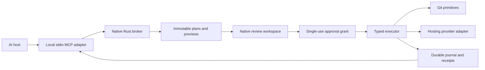

# Branchline AI Connector: engineering specification

Current execution contract: [whole exact-command approval](MCP_CONNECTOR.md). The original typed-adapter proposal below is retained as design history; it does not describe the current public proposal tool or approval scope.

Status: proposed architecture, revision 1, 26 October 2026. Implementation checkpoint: 0.4 ships a subset; see [the current connector guide](MCP_CONNECTOR.md). Global connections, repository grants, automatic prompts, clipboard receipts and target warnings follow the latest user direction. This document does not describe a shipped MCP server. Product brief: [Branchline AI Connector](https://chatgpt.com/space/page_7f8ca360cd6081919d30f7109cab90f4).

## 1. Core contract

An AI proposes a bounded Git plan. Branchline independently resolves its effects into diffs, graphs, destination refs, and provider actions. A person approves exact effects in the native app. The executor validates, performs, and verifies each approved step, then returns durable receipts.

Connecting a client grants the ability to propose; it never grants mutation approval. Read access is a separate disclosure decision. There is no MCP approval tool, unrestricted execution token, shell tool, or generic `run_git` tool.

The enforcement boundary covers operations submitted through Branchline. An agent with separate terminal or filesystem access can bypass the connector; a same-user process can also access resources available to that user. This product must not claim to sandbox an otherwise privileged agent or cryptographically identify the actual model. Stronger OS isolation would be separate work.

Approval of a batch is one consent decision, not an atomic transaction. A successful push cannot be undone because a later PR request fails.

## 2. Architecture and code seams



Recommended implementation remains Rust/Tauri. Package a small `branchline-mcp` binary alongside the desktop app; do not load an Electron service or an embedded model. A host launches one adapter subprocess. The adapter authenticates to a per-user broker over a Unix domain socket in the app's private Application Support directory. The native app owns the broker, approvals, provider credentials, journal, and execution. Closing the app stops new execution; an adapter may request a normal launch but cannot grant permission.

| Module | Responsibility |
|---|---|
| `mcp/` | Protocol/version adapters, tool schemas, bounded responses, authenticated request context |
| `ai/clients.rs` | Pairing, repository scopes, revocation, local credentials |
| `ai/repos.rs` | Opaque canonical repository/worktree handles; no global active repository |
| `ai/plans.rs` | Typed steps, dependency validation, output references, normalized immutable plans |
| `ai/preview.rs` | Independently computed effects and approval-bound fingerprints |
| `ai/approvals.rs` | Native-issued grants, expiry, revocation, step consumption |
| `ai/executor.rs` | Queues, preconditions, execution, postconditions, safe checkpoints |
| `ai/journal.rs` | Durable transitions, attempts, receipts, crash reconciliation |
| `providers/` | Authenticated PR operations with explicit provider identity |
| `git/` | Reusable typed primitives with operation-specific checks |

Current `git::Service` has a mutable root and a broad Tauri request enum. Do not expose that enum over MCP. Refactor repository handles and separate reads from mutation capabilities first. Serialize operations by canonical Git common directory, with worktree-specific identity; avoid competing ref changes across linked worktrees. A per-app mutex does not exclude external Git clients.

Use a transactional local journal, preferably SQLite, with schema migrations and durable write-ahead records before any side effect. Do not hold its transaction while Git or provider calls run. Keep secrets in macOS Keychain, never in plan JSON or tool results.

## 3. Connection, identity, and privacy

Connector is off by default. Settings → AI Connector → Add client generates a client-specific registration and shows a configuration to copy. Writing another product's configuration requires a user action and preview. Do not assume a universal one-click installation API.

1. The app enrolls a named connector instance and issues a random, revocable local credential. Store credentials in Keychain where usable; otherwise use a private credential file and a path reference, never a token embedded in copied command arguments.
2. Bind the socket to the current user with private directory permissions and peer-credential checks. Socket ownership alone does not distinguish two same-user AI hosts; authenticate each registration separately.
3. Pairing UI displays the registered connection name and available process/path evidence. A model name or MCP `clientInfo` is self-reported, visibly distinct from verified local evidence.
4. Choose exact repositories and read scopes: metadata, content, provider metadata. Even paths, authors, messages, and remote identities can be private. Never enumerate all disk repositories to a newly connected client.
5. Every tool call resolves a server-owned authenticated identity and checks scope. Reconnecting with the same credential can recover owned plans; a guessed plan ID cannot grant access.
6. Disconnect revokes the registration, suspends unstarted steps, and removes future read access. Already completed external actions remain completed.

Canonical repository identity includes canonical worktree path, Git directory, common directory, filesystem identity where supported, and a server registration generation. Revalidate against moved paths, symlinks, and replaced `.git` pointers. A host-supplied root is a hint, never authorization. No unrestricted filesystem read or remote URL creation through inspection tools.

The adapter itself does not call an AI API or upload source. Authorized MCP reads return content to the connected host, which may send it onward under that host's policy; explain this in setup. Limit history/diff sizes, paginate, and redact credentials embedded in URLs. A secret detector can warn but must not promise to find every secret. Default logs record identifiers, counts, digests, and outcomes rather than source text, PR bodies, or credentials. Review artifacts containing content remain private local data with retention controls.

## 4. MCP surface and compatibility

The official latest specification resolved to **2026-07-28** during research. It has different request metadata and lifecycle semantics from 2025-11-25. Implement an explicit compatibility layer, with fixtures for both versions, rather than mixing wire examples. Initially certify actual host/version combinations; unknown protocol versions fail clearly. All JSON below is Branchline domain payload, not a complete JSON-RPC envelope.

Use standard stdio for local hosts first. Keep stdout exclusively protocol messages. Native review is independent of MCP elicitation: a client that cannot render forms can still submit a request and poll its status. An elicitation response, opening a review URI, or a host's own tool approval is not a Branchline grant.

| Tool | Inputs | Result / authority |
|---|---|---|
| `branchline_capabilities` | Optional repository handle | Schema version, supported operations and limits; no mutation |
| `branchline_repositories` | Cursor | Only client-authorized opaque handles and permitted labels |
| `branchline_inspect` | Repo, typed query, cursor | Status/log/diff/ref/provider reads according to scope; snapshot ID and observation time |
| `branchline_propose_plan` | Repo, idempotency key, typed steps, optional AI rationale | Validates and freezes a version; computes local preview; never executes |
| `branchline_request_review` | Plan ID, expected version | Queues native review once; returns pending status promptly |
| `branchline_get_plan` | Plan ID, after-event cursor, optional bounded wait | Current version, per-step disposition, receipt/event delta |
| `branchline_cancel_plan` | Plan ID, expected version | Cancels own queued work or requests stop at the next safe boundary |

Plan amendment is a new proposal with `supersedesPlanId`; no in-place mutation of an approved record. Repeated review requests do not create repeated alerts. Initial proposed limits: 20 steps, one repository/worktree per plan, 100 pending requests per registration, 1 MiB input, bounded 20-second status wait, and explicit pagination. These limits are implementation defaults to tune, not protocol standards.

Do not hold an ordinary tool RPC open awaiting a human. Return `pending_review`, a plan ID, and a local review link; polling is the baseline. A `branchline://review/<opaque-id>` link only opens an existing review after access checks and cannot encode an approval or bearer credential. Optional protocol progress/task facilities can improve hosts that support them, but must not be required for correctness. Cancelling a transport request is distinct from cancelling a durable plan.

Annotate tool effects accurately, but tool annotations are descriptive hints, not authorization. Advertised tools and every invocation must respect the authenticated request's scope. Separate application schema version (`1`) from MCP protocol version.

Later HTTP support requires a separate design review: loopback binding is insufficient authentication. Validate Origin, Host, token audience, and resource identity; follow MCP HTTP authorization and discovery requirements. A hosted AI needs an explicitly secured local bridge or relay; do not expose the desktop broker publicly or promise remote-host support at launch.

## 5. Plan model and executable example

A plan contains server-generated ID/version, owner registration, repo handle, schema version, requested intent, normalized steps, dependency edges, immutable preview, required disclosures, preconditions, and digest. Client rationale is untrusted display text. The broker supplies authoritative fields and ignores/rejects client attempts to supply approvals or trusted preview results.

Example request after inspecting an exact staged tree:

```json
{
  "schemaVersion": 1,
  "repositoryId": "repo_example",
  "idempotencyKey": "publish-login-fix-01",
  "steps": [
    {
      "id": "commit",
      "kind": "commit.create",
      "dependsOn": [],
      "inputs": {
        "source": {"mode": "staged", "snapshotId": "snap_example"},
        "message": "Fix login redirect",
        "branchRef": "refs/heads/fix/login"
      }
    },
    {
      "id": "push",
      "kind": "remote.push",
      "dependsOn": ["commit"],
      "inputs": {
        "sourceOid": {"step": "commit", "output": "commitOid"},
        "remoteId": "remote_example",
        "destinationRef": "refs/heads/fix/login",
        "mode": "fast_forward_only"
      }
    },
    {
      "id": "pr",
      "kind": "pr.create",
      "dependsOn": ["push"],
      "inputs": {
        "providerRepositoryId": "provider_repo_example",
        "head": {"step": "push", "output": "publishedBranch"},
        "baseRef": "refs/heads/main",
        "title": "Fix login redirect",
        "body": "Correct the redirect after signing in.",
        "draft": true
      }
    }
  ]
}
```

Typed output references may refer only to declared ancestors and compatible output types. They are not string substitution, JSONPath, templates, or code. Reject cycles, duplicate IDs, unknown fields/operations, conflicting branch contexts, and dependencies outside the plan. Resolve exact repo, refs, destinations, and effect fingerprints before asking for approval. The example snapshot/digests are illustrative opaque IDs, not executable credentials.

Generated commit metadata such as timestamp, signature, and final OID may not yet exist. Approval instead binds the exact parent, tree, branch, message, identities, and signing/hook policy, then permits downstream use of that verified output. Show this distinction rather than inventing a future hash.

For stage → commit, preview the exact resultant index tree before mutation. MVP requires a clean initial index for selected-content staging plans, or explicitly commits the entire already-staged tree. Never include unrelated pre-staged files silently. Hunk selection uses snapshot-bound patch IDs, not fuzzy line numbers or AI-supplied shell patches. Preserving unrelated staged content can be added with a separately tested private-index implementation.

## 6. Approval and state machine

Recommended plan states: `draft`, `preflighting`, `pending_review`, `approved`, `running`, `waiting_review`, `succeeded`, `failed`, `partially_completed`, `denied`, `cancelled`, `expired`, `superseded`. Steps additionally distinguish `not_approved`, `queued`, `running`, `succeeded`, `failed`, `skipped`, and `outcome_unknown`. Preserve transitions as events rather than overwriting history.

The native action issues a server-owned single-use grant bound to owner, repo identity, plan digest/version, explicit step set, operation parameters, precondition fingerprints, disclosures, policy version, issuance/expiry, and a nonce. Keep the grant inside the broker; the AI gets a status, never a transferable execution secret.

Approval scopes are dependency-closed: all steps, or an initial dependency-valid subset. “Approve through Commit” approves only Commit; Push/PR remain not approved. Later consent can approve the remainder using a freshly computed preview tied to the verified earlier receipt. General DAG selection is an advanced later UI; MVP displays a linear sequence and rejects branching plans.

Recommended defaults: ten minutes to begin an approved plan, thirty minutes total grant lifetime, immediate expiry after restart, and pause on screen lock, app shutdown, registration revocation, or a required new review. Recheck validity before every step. A native approval can start execution immediately; no separate model execute call is needed.

Journal grant consumption and intent before starting each step. Multiple adapters, duplicate submissions, or concurrent native clicks cannot consume it twice. Same client + same idempotency key + same normalized payload returns the same plan; same key with different payload returns a conflict. A new key does not entitle the caller to repeat an already completed effect without a new review.

A newly appended step always requires consent. A changed input produces a new immutable version and invalidates unexecuted affected steps plus their dependents. First release conservatively re-reviews the entire unexecuted remainder; selective retention of proven-unaffected grants is deferred.

## 7. Preflight, execution, and races

Preflight reads local state without fetching, running hooks, invoking filters, or contacting providers implicitly. Preview labels remote facts as cached or observed-at-time. If fresh remote data is needed, make the network check an explicit disclosed action. Fetch can be approved without approving an unknown incoming update; inspect its result and checkpoint before applying unreviewed commits. Never offer one blind approval to “pull whatever arrives.”

| Effect | Approval-bound state |
|---|---|
| Stage/unstage | Exact path bytes, modes, index/worktree entries, patch/content fingerprints, initial index tree |
| Commit | Repo/worktree identity, symbolic branch and parent, resultant tree, message, author/committer policy, hooks/signing configuration |
| Branch/switch | Exact source and target refs/OIDs, dirty-file effects, linked worktrees, ongoing operations |
| Rewrite | Ordered old commits, replay range, expected new trees/messages, clean-state checks, backup/ref recovery |
| Push | Canonical resolved destination and push URL, refspec, all published commits, expected remote tip, mode and tags/submodule policy |
| PR | Provider host/account/repository, head/base identities and observed tips, title/body/draft, reviewers and other notification-producing fields |

Use argv arrays, validated refs/OIDs, literal pathspecs, sanitized environment, and no model command strings. Resolve repository Git configuration that can redirect transports or run helpers, including push URLs, URL rewriting, SSH commands, signing, hooks, external diff/textconv, and filters. Untrusted repository executable helpers are blocked until the native user explicitly trusts the relevant execution configuration. That separate trust is a scope decision; Git-plan approval must show which enrolled helpers may run. Revalidate helper configuration/content where feasible. Existing backend safety checks need expansion here before an MCP release.

Recompute relevant fingerprints immediately before each step, not solely on watcher events. Use Git-native locks and expected-old-value ref updates where supported. Preserve files/index on failed validation. The app cannot lock out all external Git processes, so do not promise race-free transactions across a worktree. Snapshot-bound content, Git compare-and-swap primitives, and postcondition verification reduce and detect discrepancies. [Git update-ref](https://git-scm.com/docs/git-update-ref) documents expected-old-value checks and ref transactions; those are not multi-service transactions.

For commit: ensure the tree actually created matches the approved tree; verify parent, branch, message, and identity policy before downstream publication. If a trusted hook changes content, fails, creates a different commit, or requires interaction, pause and show the actual result. Do not push a mismatched commit. Backups are not a substitute for these checks.

For push: pin the source OID to the verified dependency output, use an explicit refspec, prohibit implicit tags and recursive submodule publication. First release only normal fast-forward/new-branch pushes. For an existing destination, enforce the approved expected old OID using an explicit lease in addition to a local ancestry gate; this must never admit a rewrite. Verify the observed remote result before PR creation. For later rewrites, force-with-lease alone is not consent; require a separate rewrite operation with exact old/new OIDs. See [Git push](https://git-scm.com/docs/git-push) for lease/refspec semantics.

When remote state changes, re-review altered effects. Discovered new outgoing commits, changed PR base, changed push URL/account, and hook-caused changes are material. A UI-only spacing change is not. Fail closed when validity cannot be determined.

## 8. Provider connector and external disclosure

Git credentials and PR API authorization are different. Reuse configured Git credentials for Git transport without exposing them to MCP. Add GitHub first through a provider adapter and a registered OAuth/GitHub App flow suitable for a desktop public client; do not embed a confidential client secret. Confirm the chosen provider's supported authorization flow during implementation. Restrict authorized repositories and minimum PR permissions; keep revocable tokens in Keychain.

PR creation inputs include exact owner/repository identity, head repository/branch, base repository/branch, title/body, draft, and any reviewer/assignee/label requests. Omitted fields do not authorize inferred additions. Draft is a proposed default, visible and editable before approval. Unsupported draft permissions or provider features produce a reviewable error, not an automatic fallback to an open PR.

Show what is transmitted and under whose provider account. Render Markdown safely, disable remote image loads by default, and treat mentions and reviewer requests as notification-producing effects. Cross-fork PRs need separate head/base repository identities; defer them until their preview is implemented. PRs follow moving branches, so show observed head/base OIDs and verify them before creation rather than promising the comparison can never change later.

The [GitHub PR API](https://docs.github.com/en/rest/pulls/pulls#create-a-pull-request) supports PR creation separately from issues-related metadata operations. Treat adding reviewers/labels as separately modelled effects if the provider requires additional calls. One UI step may not hide extra authorized actions.

Do not assume PR creation provides a universal idempotency header. Persist creation intent and query matching provider records after uncertain outcomes. A pre-existing matching PR is shown for explicit reuse, not silently claimed as newly created. If multiple candidates or ambiguous state remain, stop for user reconciliation.

## 9. Operation coverage

All mutations require plan approval in the initial policy. Read grants permit only their disclosed query types. This matrix is a roadmap, not a claim of present connector support.

| Family | Operations | Review representation | Release |
|---|---|---|---|
| Inspect | Status, diff, log, refs, show commit, remote metadata | Existing file/diff/log surfaces; source-read scope | Foundation |
| Prepare | Stage/unstage exact files/hunks | Resultant index tree and included/excluded files | Foundation |
| Commit | Create staged commit | Full tree diff, message, parent/branch, identities | Foundation |
| Branch | Create/switch local branch | Ref movement and dirty-file effects | Foundation |
| Publish | Normal push, create remote branch | All outgoing commits and exact destination | Public v1 |
| Review | Create GitHub draft/open PR | Head → base graph and exact provider payload | Public v1 |
| Update | Fetch; FF update to a reviewed OID | Incoming graph; checkpoint after unknown fetch | Next |
| Apply | Cherry-pick, revert | Exact source commits and resulting changes | Next |
| Preserve | Stash create/apply/pop | Included tracked/untracked files; conflicts/drop effects | Next |
| Rewrite | Amend, squash, fixup, reword, reorder/drop unpublished commits | Before/after DAG, changed commits, backup | Next |
| Integrate | Merge, rebase, continue/abort | Branch graph, conflict checkpoint and actual resolution diff | Later |
| Organize | Rename/delete branch, create/delete tag, add/remove worktree | Exact refs, reachability, dirty/untracked data | Later |
| Discard | Restore, reset soft/mixed/hard, clean | Explicit lost index/worktree/untracked content and recovery limits | Later |
| Remote risk | Force-with-lease, remote branch/tag deletion | Exact remote old/new refs and published history loss | Later, restricted |
| Provider risk | Update/close/merge PR, comments/reviews | Exact remote content, notifications, merge method | Later |
| Advanced | Clone/init, remotes/config, submodules, LFS, bisect | Dedicated destination, execution and disclosure semantics | Separate design |

Do not route unsupported operations to an unrestricted Git command. Conflicts stop execution; they do not authorize AI resolution edits. Later conflict-resolution proposals must show the final resolved diff before continue. Operation abort and automatic cleanup must have exact preauthorized semantics; never discard unrelated edits to make a plan succeed.

## 10. Review workspace specification

Use existing soft-black layers and user appearance settings. Add one quiet AI requests entry with a count, visible when enabled/connected or requests exist. Do not add permanent chat, tool logs, or flashing status controls.

Inbox rows show trusted registration label, repo, computed outcome, step count, state and age. Rate-limit notifications, deduplicate retries, allow decline-all for a selected sender, and never move focus from an editor. Pending plans are not permission to do background network work.

Review layout: short headline and identity; compact ordered step list; existing diff/log viewer for the active step; footer with Decline, Approve through…, Approve N steps. Show local effects versus publication using labels/icons; reserve stronger emphasis for data loss, rewrites, and external disclosure. Expand only one selected step by default, but show unresolved risks on the overview.

Push preview must include already-existing outgoing commits, not just the proposed new commit. History operations show before/after graph and descendants that will be replayed. PR preview includes account/repository and rendered body with safe plain-text fallback. Source content containing instructions is data, never a policy instruction.

Stale review displays old → new facts and affected steps. Keep the same timeline during execution and receipt view. Example receipt: Commit created → Push failed → PR not started. Offer actual commit/ref/PR links, Retry as new review, and explicit recovery. Do not display a universal Undo for published work.

Keyboard: normal tab order, labelled controls, Escape dismisses review without approving/denying, Return inside a message field does not approve the plan, and initial focus is never the destructive approval button. Do not bind a global one-key approval shortcut. Maintain focus/scroll during refresh and use announced state changes. Color is redundant with text/icons. Layout must remain usable at maximum appearance font/spacing settings.

## 11. Failure, cancellation, and audit

| Situation | Required outcome |
|---|---|
| Declined | No step starts; record denial and return it without repeated prompting |
| Stale files/index/ref | Pause affected remainder; recompute preview and require consent |
| Commit succeeds, push rejected | Preserve commit; PR skipped; show actionable rejection |
| Push times out | Mark outcome unknown; inspect exact remote ref before any retry or PR |
| PR request times out | Reconcile provider records; never blindly repeat create |
| App crashes during a step | Reconcile durable intent with observed Git/provider state; no automatic mutation on restart |
| Client disconnects | Keep receipts; suspend unstarted work; re-review before resuming |
| Cancel while running | Request stop at safe boundary; completed or uncertain actions stay visible |
| Hook/credential/signing interaction | Pause or fail clearly; secrets stay in trusted native/auth interfaces |
| Protected branch/server hook rejection | Respect remote policy; never fall back to force or a different target |

Before a process is killed, assess its operation boundary. Cancellation cannot recall bytes already sent to a server. Unknown is a distinct outcome, not failure. On crash recovery, verify parent/tree/ref/provider state using recorded intent; ambiguous findings require user review. No automatic rollback of successful publication.

Each receipt records plan/version/digest, registered client, repo identity, native approval time/scope, preconditions, per-step intent/attempt IDs, start/end times, verified outputs, failures/uncertainty, and cancellation/revocation. Return an authenticated redacted view to the owner. A local hash chain or signing can help detect accidental changes but is not proof against a compromised same-user/root environment. Proposed default retention: 30 days for local receipts, configurable; avoid retaining full source snapshots longer than needed, with deletion controls that preserve honest recovery limitations.

## 12. Threats and release gates

| Threat | Required verification |
|---|---|
| Model forges approval fields or invokes old mutation endpoint | MCP cannot reach native grant issuer or broad Tauri enum; schema rejection and boundary tests |
| Prompt injection in source, commit text or PR body | Escaped untrusted rendering; no input text can change policy or trigger actions |
| Plan ID theft, replay or client impersonation | Ownership/auth checks on every call, one-use grants, revoked-registration tests |
| Path traversal, symlink swap, `.git` replacement | Canonical handle revalidation and adversarial filesystem tests |
| Another client/terminal changes index/refs | Concurrent-process tests; stale rejection and no unreviewed downstream publication |
| Malicious helper/hook/config | Trust enrollment, config invalidation, approved-tree postcondition tests |
| App/adapter crashes after side effect | Fault injection before/after each journal and Git/provider boundary |
| Notification floods or huge plans | Limits, deduplication, pagination, cancellation, and bounded rendering |
| Credential exfiltration | Redaction tests and no provider tokens in tools, URLs, exported receipts or logs |

Meaningful test matrix must include unborn/detached repositories, dirty and pre-staged changes, binary files, Unicode and option-like paths, renames/deletions, linked worktrees, SHA-256 object IDs, multiple remotes/push URLs, signed commits, hook changes, protected refs, new remote branches, pre-existing outgoing commits, conflicts, partial provider failures, reconnects, and restart reconciliation.

Protocol fixtures cover stdio framing, version metadata, unsupported capabilities, host timeout/cancel, large reads, and at least two real local hosts before public claims of interoperability. Test approval through every boundary of commit → push → PR. Add usability sessions for understanding destination, exact content, publication scope, declined steps, changed plans, and recovery. Proposed target: 8/10 pilot users correctly explain those effects; privacy-preserving timings are optional opt-in analytics.

## 13. Delivery sequence and definition of done

**A — Foundation, internal milestone.** Repository handles; separate read/mutation primitives; durable plan/grant journal; opt-in pairing; stage/commit/branch previews; native review and dependency-prefix approval. Done when no connector mutation can occur without a matching native grant and all stale/replay/crash tests pass.

**B — Public v1, the selling-point workflow.** Explicit normal push, GitHub account authorization and PR creation; complete commit → push → PR timeline; outgoing-history preview; uncertain-result reconciliation; receipts and revoke/cancel controls; certified local-host setup. Done when end-to-end success and every partial failure boundary are exercised against disposable repositories and a real provider test repository. A bare remote alone does not validate provider integration.

**C — Broader workflows.** Fetch/checkpointed update, cherry-pick/revert, stash, unpublished rewrite preview, improved recovery. Each operation needs its own effect schema, stale checks, receipt outputs and tests before advertising support.

**D — Advanced risk.** Destructive local operations, remote rewriting/deletion, merges/conflicts, provider merges, managed policies, optional HTTP/remote bridges. Separate reviews; do not delay the core launch for blanket Git coverage.

Open decisions: first host certification list; GitLab launch priority; helper trust enrollment details; hosted-client demand; retention defaults; stronger isolation scope. Recommended defaults in this document are proposed product choices, not claims that the user has approved implementation.

## 14. Primary references

Research checked 26 October 2026. Pin and recheck exact protocol/provider versions when implementation starts.

- [MCP specification 2026-07-28](https://modelcontextprotocol.io/specification/2026-07-28): protocol baseline.
- [MCP transports](https://modelcontextprotocol.io/specification/2026-07-28/basic/transports): standard local/HTTP bindings.
- [MCP tools](https://modelcontextprotocol.io/specification/2026-07-28/server/tools): tool schemas and human control model.
- [MCP authorization](https://modelcontextprotocol.io/specification/2026-07-28/basic/authorization): HTTP authorization scope; distinct stdio treatment.
- [MCP security practices](https://modelcontextprotocol.io/docs/2025-11-25/tutorials/security/security_best_practices): confused-deputy, token and local-server threats; guidance version labelled explicitly.
- [Git update-ref](https://git-scm.com/docs/git-update-ref) and [Git push](https://git-scm.com/docs/git-push): ref consistency and remote update primitives.
- [GitHub pull requests API](https://docs.github.com/en/rest/pulls/pulls#create-a-pull-request): provider effects and permission requirements.
